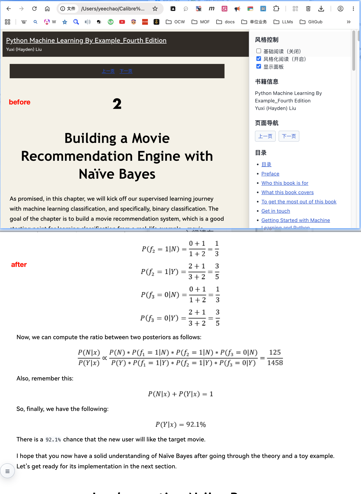

# Calibre Automa Reader

[简体中文](README_cn.md)

A browser-based Automa workflow that improves the reading layout of local Calibre ebook pages. The final workflow targets Calibre `file://` pages and adds a responsive content layout, reader styling, and a floating control panel.

> **Workflow:** `workflow-v10-calibre-reader-floating-ball-fixed.automa.json`  
> **Automa baseline:** `1.30.02`  
> **Status:** Static validation passed. Browser import, runtime behavior, and visual results still require testing in the target browser.

## Features

- Centers `.calibreEbookContent` in a responsive reading area, with a maximum width of about `1100px` on wide screens.
- Adapts the content width to narrow viewports and constrains images to reduce horizontal overflow.
- Adds a circular floating button at the left side of the page. Clicking it toggles the reader control panel, which is collapsed by default.
- Removes elements injected by earlier versions before applying the current styles, preventing duplicate controls on repeated runs.
- Uses no external dependencies or network requests, and does not modify the ebook source files.
- Uses an Automa URL trigger and the active browser tab to target a Calibre page.

The workflow currently consists of three connected nodes:

```text
Visit matching Calibre file:// page
                 |
                 v
        Select active tab
                 |
                 v
 Apply reader layout and controls
```

## Requirements

- Calibre installed, with the target ebook opening as a local HTML/XHTML reading page.
- Automa `1.30.02` installed in a supported browser.
- Automa's **Allow access to file URLs** permission enabled.
- The target Calibre page available as the active browser tab when testing.
- Python 3 for generating a workflow configured for your library path.

## Prepare the Ebook

The workflow operates on a local HTML/XHTML page generated or opened by Calibre; it does not run directly on a ZIP archive.

1. Import the ebook into Calibre or select it in your library.
2. Convert it to a format Calibre can open in its ebook viewer.
3. If the source is an archive, confirm it contains the HTML/XHTML documents and their image and stylesheet resources, then import or convert it through Calibre.
4. Open the actual reading page in the browser and confirm that the page contains `.calibreEbookContent`.

The ZIP is only an import or resource-preparation format. This workflow does not extract or modify ZIP files or other library contents.

## Configure the Library Path

The browser URL for a local library may percent-encode spaces and non-ASCII characters. Do not guess the encoded URL manually. Use the path patcher to update both the Automa URL trigger and the JavaScript URL-prefix check.

Interactive mode:

```bash
python3 scripts/patch_calibre_library.py \
  --input automaplans/calibre-file-probe-20261019/workflow-v10-calibre-reader-floating-ball-fixed.automa.json \
  --output workflows/calibre-reader-v10-local.automa.json
```

The script prompts for the absolute Calibre library directory. Or pass it directly:

```bash
python3 scripts/patch_calibre_library.py \
  --library "/path/to/user/Calibre Library" \
  --output workflows/calibre-reader-v10-local.automa.json
```

The patcher accepts an absolute local path or a local `file://` URL. It percent-encodes the path, validates that the expected trigger and JavaScript prefix fields are present, parses the resulting JSON, and refuses to overwrite an existing output file. The original v10 workflow remains unchanged.

## Import and Run

1. Generate a local workflow with the path patcher.
2. In Automa, import `workflows/calibre-reader-v10-local.automa.json`.
3. Confirm that the expected three nodes and the URL trigger configuration appear in the editor.
4. Enable **Allow access to file URLs** for Automa in the browser's extension settings.
5. Open a Calibre ebook page under the configured library path and keep it as the active tab.
6. Run the workflow and check the content layout, floating button, and panel toggle behavior.

The unpatched release template is available at [`workflows/calibre-reader-v10.automa.json`](workflows/calibre-reader-v10.automa.json). It contains the development machine's example path and should be patched before use on another machine.

## Validation

Static checks recorded for v10 include:

- Valid JSON and Automa `1.30.02` metadata.
- The `drawflow.nodes` and `drawflow.edges` schema family.
- Unique node IDs, valid edge endpoints and handles, and reachability of all three nodes.
- Consistent v10 floating-button DOM and CSS IDs.
- Responsive content centering, collapsed initial panel state, and image-centering rules.

Detailed records: [`v10-validation.md`](automaplans/calibre-file-probe-20261019/v10-validation.md), [`acceptance-v10.md`](automaplans/calibre-file-probe-20261019/acceptance-v10.md), and [`plan-v10-floating-ball-fix.md`](automaplans/calibre-file-probe-20261019/plan-v10-floating-ball-fix.md).

Static validation does not establish that Automa imports or recognizes every node correctly, that the workflow runs on a particular browser, or that the visual result is correct. Browser import, parameter round-trip, floating-button interaction, responsive layout, and automatic `file://` trigger behavior remain subject to testing in the target environment. The current acceptance record marks those runtime cases as not run.

## Repository Layout

```text
.
├── README.md
├── README_cn.md
├── scripts/
│   └── patch_calibre_library.py
├── workflows/
│   └── calibre-reader-v10.automa.json
├── automaplans/
│   └── calibre-file-probe-20261019/
│       ├── workflow-v1...v10*.automa.json
│       ├── plan*.md
│       ├── validation*.md
│       └── acceptance*.md
└── MEMORY.md
```

`README.md` is the English project entry point. `README_cn.md` contains the Simplified Chinese documentation. `automaplans/` preserves the design history, workflow revisions, and acceptance records; `workflows/` contains the release template; and `scripts/` contains the path configuration utility.

## Limitations

- The workflow depends on Calibre's page structure and the `.calibreEbookContent` selector. A change to the reader page may require an update.
- Automatic triggering on `file://` pages must be verified with the target browser and extension permissions. Manual execution on the intended active tab is useful for initial testing.
- Browser file-URL permission and extension injection behavior may differ between browsers.
- The patcher changes only the recognized workflow path fields; it does not scan or modify ebook files.

## License

No open-source license has been selected for this repository. Add a `LICENSE` file after confirming the intended distribution rights.
